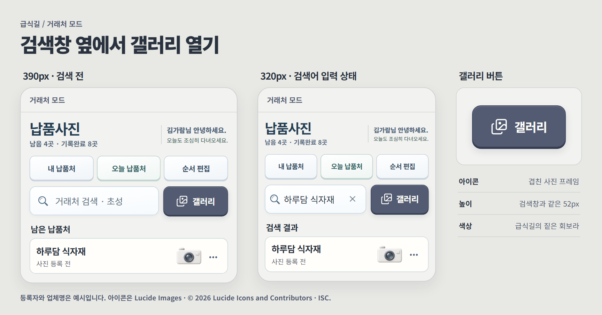
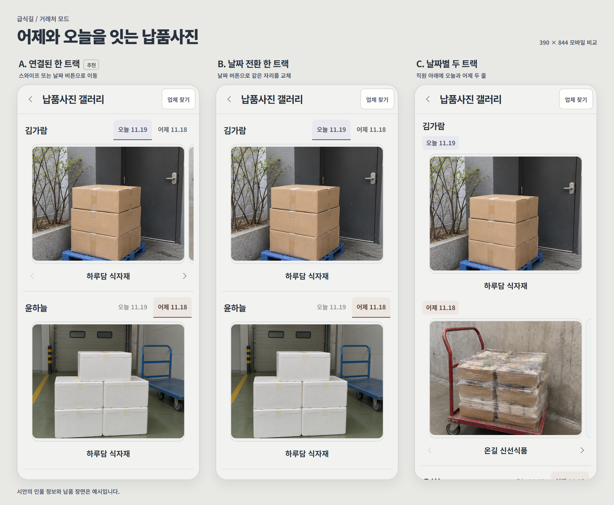
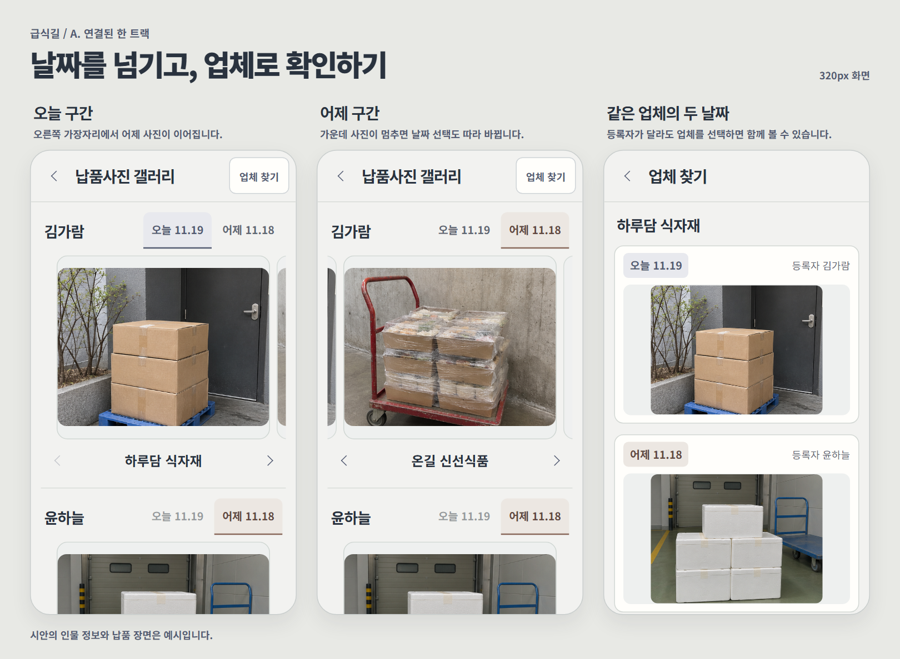

# 어제와 오늘을 잇는 납품사진 갤러리

2026-11-19 KST · 코드 기준 `9cbcd5b` · 현장 문의 대응을 위한 설계 검토

**직원마다 연결된 가로 트랙 하나를 두고, 상단에서 ‘오늘’과 ‘어제’로 바로 건너뛰는 A안을 추천합니다.** 평소에는 스와이프로 두 날짜를 이어 봅니다. 미입고나 제품 위치 문의가 들어오면 상단의 **업체 찾기**에서 등록자와 관계없이 해당 업체의 두 날짜를 바로 확인합니다. 같은 업체의 오늘 사진이 저장되면 최신 사진이 갱신되고, 어제 자료는 대조할 수 있게 남습니다.

## 업무에서 구분해야 할 날짜

갤러리의 범위는 서울 기준 **어제와 오늘 두 달력일**입니다. 화면 이름은 ‘납품사진 갤러리’로 제안합니다. 사진 위의 조작 영역에 **오늘 11.19**, **어제 11.18**을 표시하고 현재 날짜에 밑줄과 강조색을 줍니다. 사진 아래에는 업체명만 표시합니다. 사진을 확대해 세부를 확인할 때도 등록일 표시는 확대 화면의 머리말에서 읽을 수 있게 합니다.

현재 코드의 `deliveryDateKey`와 `createdAt`은 처음 등록 요청을 처리한 서버 시점에 정해집니다. 전날 찍은 앨범 사진을 오늘 새로 등록하면 오늘 등록이고, 자정 전 시작한 요청이 재시도에서 같은 ID로 확정되면 서버가 보낸 날짜를 따릅니다. 화면의 날짜 표기는 ‘오늘 11.19’, ‘어제 11.18’ 두 버튼으로 충분합니다. [서버 날짜 생성](../functions/src/delivery-photo/delivery-photo-service.ts#L468) · [메타데이터 계약](../functions/src/delivery-photo/delivery-photo-contract.ts#L108)

## 납품사진 검색창 옆의 갤러리 버튼

기존 세 개의 납품처 관리 버튼 아래에 있는 **거래처 검색 줄**에서 검색창 폭을 줄이고, 오른쪽에 **갤러리** 버튼을 둡니다. 검색창과 버튼은 높이 52px, 간격 8px입니다. 정적 시안에서 390px 화면은 검색창 232px·버튼 116px, 320px 화면은 182px·104px로 렌더링했습니다. 좁은 폭에서는 검색창 안쪽 여백을 조정해 16px 입력 글자와 기존 지우기 버튼을 확보합니다. 넓을 때는 ‘거래처 검색 · 초성’, 320px에서는 ‘거래처 검색’으로 표시합니다. [현재 툴바 위치](../src/features/delivery-photos/delivery-photo-toolbar.tsx#L44) · [검색 필드 높이와 내부 조작](../src/components/ui/search-field.module.css#L1)

아이콘은 사진 프레임이 두 장 겹친 **Lucide Images**를 골랐습니다. `Gallery Horizontal End`와 `Gallery Thumbnails`도 비교했으며, `Images`에는 산과 점이 있어 작은 크기에서도 사진을 보는 버튼임을 알아보기 쉽습니다. 21px 아이콘과 15px 흰 글자를 짙은 회보라 `#535b72` 표면에 놓았습니다. 글자 대비는 시안 색상으로 6.7:1이며 가는 윗선과 얕은 하단 그림자로 버튼을 구분합니다. 카메라 아이콘이 있는 기존 촬영 카드와 함께 배치해 두 조작의 형태를 팔레트 안에서 분명히 했습니다. 구현에서는 겹친 프레임과 사진 모양을 기존 24×24 `Icon` 규격에 맞춰 그렸습니다. [Lucide Images](https://lucide.dev/icons/images) · [갤러리 프레임형](https://lucide.dev/icons/gallery-horizontal-end) · [썸네일형](https://lucide.dev/icons/gallery-thumbnails) · [Lucide 라이선스](https://lucide.dev/license)

갤러리에서 돌아오면 이전 검색어·목록 위치를 복원하고 진입 버튼에 포커스를 둡니다. 검색어 입력·지우기와 갤러리 열기는 같은 줄의 독립 조작입니다. 200% 글자 확대나 더 좁은 안전 영역에서 두 조작이 만나면 줄바꿈을 허용합니다. 아이콘은 보조기술에서 숨기고 버튼의 접근성 이름은 화면과 같은 ‘갤러리’로 두었습니다.

## 한 트랙과 두 트랙 비교

| 안 | 날짜 이동과 식별 | 여러 직원과 업무 대조 | 판단 |
| --- | --- | --- | --- |
| **A. 연결된 한 트랙** | 오늘 사진 묶음 다음에 어제 묶음이 이어집니다. 반대 날짜 버튼을 한 번 누르면 그 구간으로 바로 이동합니다. | 정면 사진을 크게 쓰면서 390×844 시안의 첫 화면에서 두 직원과 표시 날짜를 읽을 수 있습니다. 업체를 아는 문의는 별도 업체 찾기로 바로 들어갑니다. | **추천.** 둘러보기와 빠른 날짜 이동을 모두 지원합니다. 넘기는 동안 사진·업체명·선택 날짜가 섞이지 않도록 정착점을 맞춰야 합니다. |
| B. 날짜 전환 한 트랙 | 한 날짜씩 같은 자리에서 보고, 버튼으로 바꿉니다. 날짜별 마지막 사진에서 해당 묶음이 끝납니다. | 화면 밀도는 A와 비슷합니다. 날짜가 다른 사진이 옆에 보이지 않아 인지 부담이 낮습니다. | 현장 검증에서 A의 날짜 경계가 헷갈리거나 실기기 스냅이 불안정하면 우선 비교할 대안입니다. |
| C. 날짜별 두 트랙 | 직원 이름 한 번 아래 오늘 줄과 어제 줄을 독립 배치합니다. | 같은 직원의 양일 대표 사진을 한 번에 보는 데 유리합니다. 같은 사진 크기로 비교하면 390×844에서 첫 직원의 두 줄이 화면을 거의 채웁니다. 여러 직원이나 다른 등록자의 같은 업체를 찾을 때 스크롤이 길어집니다. | 두 날짜를 동시에 보는 구조는 **업체 찾기 결과**에 활용합니다. |

합성 사례를 놓고 세 가지 작업을 비교했습니다. 한 직원의 오늘 사진을 8장 지나야 어제가 시작되는 경우 A와 B 모두 **어제 버튼 1회**로 건너뜁니다. C는 화면에 두 번째 트랙이 들어오면 버튼 없이 바로 확인할 수 있습니다. 등록자가 많은 날에는 A와 B에서 다음 직원이 더 일찍 보였습니다. 동일 업체의 오늘·어제 등록자가 다른 사례에서는 세 안 모두 직원 줄만 훑으면 업체 위치가 흩어졌습니다. 업체 ID를 먼저 선택하면 양일 사진을 한 화면에서 확인할 수 있었습니다. 이 비교는 동일한 합성 데이터와 정적 모바일 시안으로 진행했습니다.

## 추천안의 화면과 조작

- **평소 둘러보기.** 두 날짜를 `createdByEmployeeId`별로 묶습니다. 같은 이름의 직원도 각각의 줄이 생기며, 각 줄에서는 가장 최근 사진에 저장된 `createdByName`을 18px로 한 번 표시합니다. 날짜 버튼은 같은 줄 오른쪽에 두고 좁거나 이름이 길면 한 줄 내려갑니다. 각 날짜 안에서 최신 등록 사진부터 시작합니다. 급식길의 밝은 중립 표면과 잉크색을 사용하고, 선택 날짜는 글자·밑줄·채우기 모두로 표시합니다. 시안의 4:3 정면 사진 영역은 320px 화면에서 약 **254×191px**, 390px에서 약 **324×243px**입니다. 세로 사진은 동일 프레임 안에서 높이를 쓰고, 긴 상호는 업체명 영역에서 줄바꿈합니다.
- **날짜 경계.** 오늘 묶음의 마지막 사진에서 다음으로 넘기면 어제 첫 사진이 이어집니다. 사용자 입력이 끝나고 중앙이 확정되면 사진 ID·업체명·날짜 강조를 함께 갱신합니다. 두 장이 중앙에 걸쳐 있는 동안에는 업체명 자리를 비웁니다. 날짜 버튼을 누르면 해당 날짜에서 마지막으로 보던 사진 또는 가장 최근 사진으로 바로 이동합니다. 구간을 크게 건너갈 때는 대상 사진에 바로 정착시켜 중간 사진을 빠르게 흘려 보내지 않습니다. 양끝에서는 이동 가능한 쪽을 표시합니다.
- **어제만 있거나 오늘만 있는 직원.** 있는 날짜가 먼저 열립니다. 두 날의 조회가 각각 끝나야 비어 있는 날짜를 확정합니다. 한 날짜의 목록이 로딩 중이면 그 날짜는 확인 중으로 표시합니다. 두 날 모두 사진이 없는 직원은 줄을 만들지 않습니다. 트랙에 사진이 한 장이면 정면 사진과 관련 날짜만 조작할 수 있고, 진행 화살표는 표시하지 않습니다.
- **미입고 문의.** 상단 ‘업체 찾기’에서 거래처명·초성으로 찾고 결과에서 업체를 선택합니다. 같은 이름의 업체는 기존 거래처 식별자와 주소 등 확인 정보로 구분합니다. 선택 후에는 해당 업체의 **오늘과 어제 섹션**을 위아래에 놓고 실제 등록자와 이미지를 함께 보여 줍니다. 각 날짜의 최신을 먼저 보며 같은 날짜의 추가 각도도 열 수 있습니다. 사진을 탭하면 기존 큰 사진 읽기·확대를 사용합니다. 이전 날짜가 필요하면 해당 업체의 기존 사진 이력으로 이어집니다. 뒤로 가면 직원 줄의 스크롤과 사진 선택을 복원합니다. [거래처 검색](../src/features/customers/customer-search.ts#L5) · [날짜별 사진 이력](../src/features/delivery-photos/delivery-photo-history-dates.tsx#L31)

## 새 사진이 저장될 때

업체의 **처음 열리는 사진**과 **두 날짜의 사진 기록**은 갱신 범위가 다릅니다. 첫 사진은 가장 최근 등록본으로 바뀝니다. 날짜별 기록은 등록 건마다 유지하고, 화면을 떠난 이미지의 임시 메모리는 회수합니다.

| 상황 | 화면에서 보이는 결과 |
| --- | --- |
| A업체에 어제 사진만 있음 | 업체를 열면 어제 사진을 먼저 보여 줍니다. 오늘 영역은 조회가 끝난 뒤 ‘오늘 등록 사진 없음’으로 표시합니다. 직원 전체 갤러리에서는 어제 사진을 올린 직원의 어제 구간에서 볼 수 있습니다. |
| A업체에 오늘 사진 첫 저장 성공 | 오늘 구간에 새 사진이 추가되고, 이후 업체에 들어가면 오늘 것이 먼저 보입니다. 어제 사진을 펼쳐 둔 사용자는 같은 사진에 머물고 날짜 버튼으로 새 사진을 확인합니다. |
| 오늘 같은 업체에 사진을 여러 장 저장 | 서로 다른 `photoId`는 모두 해당 날짜에 남습니다. 최신이 첫 사진이 되므로 상자·장소별로 다른 각도도 확인할 수 있습니다. 같은 요청의 재시도는 같은 ID로 한 번만 반영합니다. |
| 오늘과 어제의 담당 직원이 다름 | 각 사진은 실제 등록자 줄에 들어갑니다. 업체 찾기에서 같은 `customerId`로 합쳐 두 날짜와 각 등록자를 비교합니다. |
| 저장 대기·실패·권한 변경 | 전송 중인 로컬 미리보기는 전송함에 나타납니다. 갤러리는 서버 확정 응답을 받은 항목을 반영합니다. 권한이 바뀌면 조회와 이미지 접근을 차단하고 갤러리 메모리를 정리합니다. |
| 다른 기기에서 저장 | 재진입·복귀 또는 업체 결과를 열 때 승인된 경로로 다시 조회합니다. 업체 결과에서 확인이 진행 중이면 이를 표시합니다. |
| 삭제가 서버에서 확인됨 | 해당 사진을 지우고 같은 날짜의 인접 사진으로 정착합니다. 그 날짜에 다른 사진이 없다면 날짜 선택 가능 여부를 갱신합니다. |

여기서 폐기하는 대상은 **현재 화면에 필요 없어진 Blob URL과 디코딩 참조**입니다. 어제와 오늘의 서버 사진은 각각 현행 7일 보관을 따릅니다. 갤러리용 복제본이나 날짜별 저장 문서는 0개입니다. [서버 저장 완료](../functions/src/delivery-photo/delivery-photo-service.ts#L525) · [클라이언트의 확인된 업로드 반영](../src/features/delivery-photos/use-delivery-photo-uploads.ts#L41) · [168시간 보관](../functions/src/delivery-photo/delivery-photo-contract.ts#L10) · [기존 삭제 권한](../functions/src/delivery-photo/delivery-photo-service.ts#L682)

## 모바일 움직임과 기술

**정면 한 장과 옆 사진 가장자리를 쓰는 네이티브 가로 스냅을 기본으로 추천합니다.** 브라우저가 손가락의 이동·관성·가로와 세로의 축 선택을 처리하고, 사진은 중앙에 스냅합니다. 옆으로 벗어난 사진만 약 3% 작고 조금 옅게 보였다가 중앙에서 원래 크기와 불투명도로 돌아옵니다. 이 강조 효과는 지원되는 환경의 이미지 내부에만 적용해 스냅 위치와 독립시킵니다. 날짜 밑줄은 정착 직후 짧게 이동합니다. 효과가 축소되거나 꺼져도 큰 사진·인접 사진의 가장자리·선택된 날짜를 읽을 수 있습니다. 실제 관성과 정착 시간은 브라우저에 맡깁니다. [CSS Scroll Snap 표준](https://www.w3.org/TR/css-scroll-snap-1/) · [Chrome의 캐러셀 가이드](https://developer.chrome.com/docs/modern-web-guidance/guides/ui-components/carousel) · [스크롤 효과와 동작 줄이기](https://developer.chrome.com/docs/modern-web-guidance/guides/ui-behaviors/scroll-entry-exit-effects)

| 구현 방식 | 이번 두 날짜 구조에서의 판단 |
| --- | --- |
| **가로 스크롤 + CSS Scroll Snap** | `scroll-snap-type: x mandatory`와 `scroll-snap-align: center`로 정착을 관리합니다. 날짜를 지날 때 앞뒤 사진을 문서 순서대로 읽을 수 있습니다. 사진 크기와 위치를 알 수 있는 HTML을 쓰며, 상시 회전이나 프레임별 React 업데이트가 필요 없습니다. 빠른 플릭 중 `scroll-snap-stop: always`의 한 장 정착은 두 실기기에서 확인합니다. |
| 앞선 정면 중심 원호의 2D 투영 | 뒤에서 돌아오는 감각이 강하고 관성을 직접 조정할 수 있습니다. 포인터 캡처·축 판정·회전 슬롯의 가상화와 날짜 경계를 별도로 유지해야 합니다. 컨테이너 두 날짜를 읽는 흐름과 조작의 첫 반응을 같은 조건에서 비교합니다. |
| CSS 3D 원통·분할 곡면 | 옆과 뒤에 놓인 사진 표현이 풍부합니다. 기존 조사에서 React Bits 데모 열 장에 `img` 노드 160개가 관찰됐습니다. 여러 직원 줄에서 사진 면적과 합성 비용을 비교해야 하므로 이번 안의 비교 기준으로 사용합니다. [React Bits](https://reactbits.dev/components/circular-carousel) |

정착 이벤트는 `scrollend`를 우선 사용합니다. 이전 Safari 등 이벤트가 없으면 스크롤이 멈춘 뒤 중심 오차를 확인해 상태를 반영합니다. 빠르게 날짜를 바꾸거나 늦은 정착 이벤트가 올 때도 현재 트랙의 실제 중심 사진과 맞는지 확인합니다. 날짜 버튼과 이전·다음 버튼은 각각 44px 이상이며 터치, 키보드, VoiceOver·TalkBack을 지원합니다. 스크린 리더에는 정착한 업체명과 등록일을 한 번 안내합니다. 동작 줄이기에서는 장식 이동과 자동 부드러운 스크롤을 끄고 버튼 전환은 즉시 반영합니다. [Safari 26.2의 scrollend](https://webkit.org/blog/17640/webkit-features-for-safari-26-2/#scrollend) · [WAI 캐러셀 패턴](https://www.w3.org/WAI/ARIA/apg/patterns/carousel/) · [WCAG 드래그 대체 조작](https://www.w3.org/WAI/WCAG22/Understanding/dragging-movements)

### 브라우저에서 확인한 정착과 갱신

합성 사진 자리 두 줄을 놓고 Playwright Chromium 151과 Windows WebKit 26.5에서 320px·390px의 중앙 정착을 확인했습니다. 시작 사진과 맨 끝 사진, 오늘에서 어제로의 프로그램 이동은 네 조건 모두에서 중앙 오차 **0 CSS px**였습니다. 다른 트랙의 가로 위치도 0px 이동했습니다. 어제 첫 사진을 보고 있을 때 앞에 오늘 카드를 추가하는 실험에서는 WebKit의 기본 위치가 **한 카드 간격** 밀렸고, 250ms 추가 대기 뒤에도 오차가 320px 환경에서 264px, 390px 환경에서 334px였습니다. 재배치 후 보고 있던 `photoId`를 중심으로 복구하면 다시 0px였습니다. 따라서 새 기록이 들어올 때 **직원 ID·사진 ID로 위치를 복원하고, 거래처명·날짜를 같은 사진 기준으로 반영**합니다. Chromium 모의 터치는 입력 중 가로 이동을 보여 줬고, 끝까지 이어지는 정착과 디코드가 겹칠 때의 성능은 실기기 검증에 남았습니다.

## 조회, 이미지 로딩, 자정 교체

1. **진입.** 납품사진 검색창 오른쪽의 갤러리 버튼에서 내부 화면으로 이동하며 앱 셸의 뒤로 가기 이력을 사용합니다. 먼저 제목과 날짜의 사진 자리를 표시합니다. 날짜를 계산하고 같은 세션의 갱신된 오늘 목록이 있으면 재사용합니다. 갤러리 전용 본문 청크와 이미지 읽기는 진입할 때 시작하고, PWA 선캐시에 전용 청크가 먼저 들어가는지도 확인합니다. [기존 화면 전환](../src/features/app-shell/app-shell.tsx#L472) · [로딩 경로의 선행 조사](today-delivery-photo-gallery-design-20261119.md#화면이-뜨는-경로)
2. **두 날짜의 목록.** `today`는 서버가 정한 당일 목록이고 500개 원시 문서 상한이 있습니다. 기존 `customer` 분기는 한 거래처에 한해 날짜를 지정할 수 있습니다. 갤러리에서는 당일 `today` 읽기를 공유하고, 전사 어제 조회와 잘린 당일 이어 읽기를 위해 **서버가 오늘·어제 범위로 제한하는 날짜별 페이지 분기**를 설계합니다. 기존 `listDeliveryPhotos`와 날짜 색인·App Check·등록자 메타데이터를 재사용합니다. 어제 목록이 오늘 첫 사진의 표시를 막지 않으며, 사용자가 어제를 누르거나 오늘에 사진이 없으면 어제 읽기를 우선합니다. 페이지는 날짜별로 순차 조회하고 원시 마지막 문서의 `createdAt`·문서 ID 커서로 진행합니다. 필터링 후 빈 페이지·동률·500건 초과도 커서를 전진시키며 `photoId`로 중복을 제거합니다. 스캔이 끝나기 전 끝이나 빈 목록으로 확정하지 않습니다. [현재 조회 분기](../functions/src/delivery-photo/delivery-photo-service.ts#L585) · [날짜 조회 색인](../firestore.indexes.json#L44)
3. **업체 한 곳의 확인.** 기존 거래처 카탈로그에서 업체 ID를 고릅니다. 두 날짜에 완전하고 최신인 결과가 있으면 필터링해 바로 그립니다. 더 최신 여부를 확인하거나 전체 페이지가 아직 내려오는 중이면 선택한 **한 업체만** 필요 날짜를 지정해 권한 있는 이력 조회를 호출합니다. 현행 호출의 반환 상한은 날짜당 30장입니다. 30장에 도달한 경우 완전한 결과로 간주하지 않고 날짜 페이지 진행 상태와 합칩니다. 조회 확인 중·실패·기록 없음은 각각 다른 상태로 표시합니다. [업체 이력 호출](../src/features/delivery-photos/delivery-photo-history-repository.ts#L71) · [거래처 카탈로그](../src/features/delivery-photos/use-delivery-photo-catalog.ts#L11)
4. **보호 이미지.** 오늘·어제를 함께 받은 메타데이터로 프레임을 예약합니다. 첫 줄 중앙의 640px 썸네일이 최우선이고, 이후 보이는 줄 중앙과 다음 사진 위주로 요청합니다. 양일 사진을 같은 권한으로 확인하고 명시적으로 확대할 때 저장용 큰 사진 한 장을 가져옵니다. 중복 브라우저 요청은 `세션·권한 버전·보기 날짜 범위·photoId·variant` 기준으로 합칩니다. 가려진 줄은 이미지 참조와 디코딩 작업을 줄이고, 미사용 Blob은 수를 제한해 정리합니다. Callable에 이미 들어간 HTTP 요청은 돌아올 수 있으므로 화면 범위와 선택이 달라졌으면 변환·적용 전에 결과를 거릅니다. [App Check와 Callable](../functions/src/delivery-photo/delivery-photo-callables.ts#L27) · [이미지 권한·만료 검증](../functions/src/delivery-photo/delivery-photo-service.ts#L633) · [클라이언트 이미지 수신](../src/features/delivery-photos/delivery-photo-history-repository.ts#L82)
5. **자정과 복귀.** 서울 자정에는 `{오늘 19일, 어제 18일}`을 `{오늘 20일, 어제 19일}`로 교체합니다. 19일 사진은 새 범위에서 다시 유효함을 확인하면 **같은 사진**에 머물고 날짜가 ‘어제’로 바뀝니다. 18일은 이 갤러리 범위를 벗어나므로 임시 이미지와 상태를 정리합니다. 기존 이력에서 해당 날을 확인할 수 있습니다. 페이지를 오래 열어두거나 복귀해도, 먼저 범위와 세션을 확인한 뒤 표시합니다. 이전 범위의 목록·이미지·디코드 응답은 새 범위에 적용하지 않습니다. 날짜 교체 시 네트워크가 없으면 연결 안내를 표시합니다. [현행 서울 날짜 계산](../src/features/delivery-photos/delivery-photo-memory.ts#L13) · [현행 자정·복귀 경로](../src/features/delivery-photos/use-delivery-photo-data.ts#L53)

## 다음 검증 기준

| 확인 과제 | 다음 구현에서의 통과 조건 |
| --- | --- |
| 미입고 문의 | 같은 업체가 어제와 오늘 서로 다른 직원에게 기록된 경우, 업체명 검색과 선택으로 두 날짜의 해당 사진만 확인합니다. 오늘 새로 한 장 이상 저장해도 어제 사진을 같은 업체 화면에서 계속 찾을 수 있습니다. 날짜나 업체를 잘못 짚는 사례를 기록합니다. |
| 날짜 표시와 이동 | 320px·390px, 0/1/여러 명, 날짜 한쪽만 있음, 1장/다수 사진, 긴 이름, 가로·세로, 200% 확대에서 날짜를 분명히 읽을 수 있습니다. 한 직원의 날짜 이동이 다른 직원의 위치를 바꾸는 횟수 0건, 정착 후 사진·업체·날짜 불일치 0건입니다. |
| 검색창과 진입 버튼 | 320px·390px 기본 폭에서 같은 줄로 보이고, 입력 중 갤러리와 지우기 조작의 영역이 겹치지 않습니다. 키보드가 열린 상태에서 진입한 뒤 돌아와 검색어·목록 위치·갤러리 버튼 포커스를 복원합니다. 고대비와 글자 확대에서도 버튼 이름과 초점이 읽힙니다. |
| 저장·삭제·자정 | 어제 보는 중 오늘 사진 추가, 다른 직원 추가, 활성 사진 삭제, 자정을 넘기는 지연 응답과 재시도, 오프라인 복귀, 권한 변경, 뒤로 가기와 확대 복귀를 확인합니다. 접수 후 저장 완료된 사진만 나타나고, 새 범위에서 벗어난 이미지를 표시하는 프레임은 0입니다. |
| 성능 | 기존 납품사진에 갤러리 전용 코드·이미지 추가 요청 0건. 첫 화면 p75 150ms, 보통 망에서 오늘 메타데이터 준비 시 첫 사진 p75 0.8초를 초기 목표로 둡니다. 어제만 있을 때도 첫 사진을 재므로 오늘 유무가 어떤 병목을 만드는지 알 수 있습니다. 40명·날짜별 500장 초과와 느린 망에서 날짜별 결과의 완전성, 실제 POST 수·바이트, Blob과 디코드 메모리, 스냅 전후 프레임을 기록합니다. |
| 실기기 선택 | 저사양 Android Chrome과 iPhone Safari·설치 PWA에서 A·B의 조회 시간, 날짜 오인, 대각선 세로 스크롤과 빠른 날짜 전환을 비교합니다. 작은 화면의 식별이 자주 틀리면 B의 단일 날짜 전환을 다시 비교합니다. 같은 업체의 양일 대조가 주된 과제라면 업체 결과의 오늘·어제 섹션을 먼저 검증합니다. |

## A안 로컬 구현 확인

납품사진 검색창 오른쪽에 겹친 사진 아이콘과 ‘갤러리’ 버튼을 배치했습니다. 독립 화면에서는 뒤로 가기, 제목, 업체 찾기부터 표시합니다. 직원 트랙에는 ‘오늘’·‘어제’ 날짜 버튼과 가운데 업체명을 둡니다.

로컬 Firebase 에뮬레이터에서 카메라 저장 응답을 보류하고, 먼저 같은 직원의 어제 사진을 가운데에 놓은 뒤 저장을 완료했습니다. Chromium과 Windows WebKit에서 새 사진이 앞에 들어온 직후 20프레임의 최대 중앙 오차는 320px 화면에서 0.36 CSS px, 390px에서 0.18 CSS px 이내였습니다. 다른 직원 트랙의 가로 이동은 0px였습니다. 업체 전체 목록을 지연시키고 어제 사진만 있는 업체를 먼저 연 경우도 확인했습니다. 오늘 첫 사진이 다른 직원에게서 들어왔을 때 기존 어제 사진의 가로·세로 이동은 두 브라우저 모두 0px였고, 업체에 다시 들어가면 오늘 사진이 먼저 나왔습니다. 업체 대조에서 어제 사진을 확대하고 다른 직원이 오늘 사진을 추가한 뒤에도 같은 원본이 열려 있었습니다. 실물 휴대폰의 프레임 시간과 위 표의 p75 진입 속도는 별도 측정 항목입니다. [인증된 브라우저 검증](../tests/e2e-auth/delivery-photo-field.spec.ts) · [이미지 요청 재사용·해제 검증](../src/features/delivery-photos/gallery/gallery-thumbnails.test.ts)
