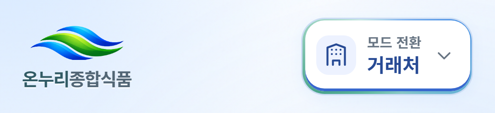
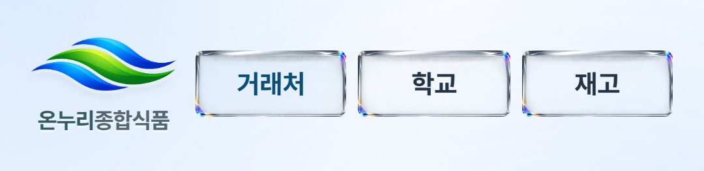
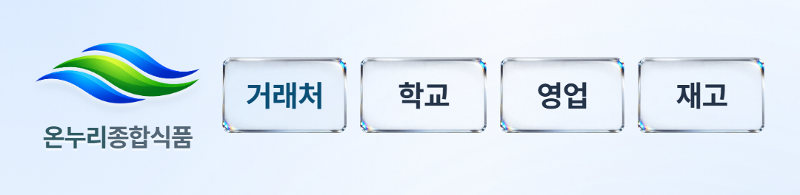
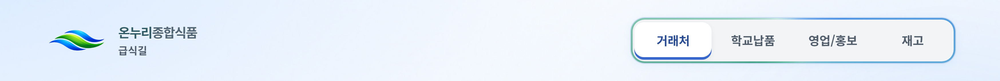
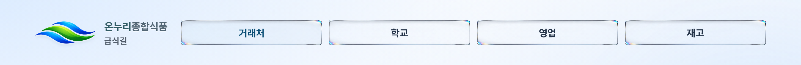

# 2026-10-30 업무 모드 유리 버튼

## 확정한 화면

로고 오른쪽에 `거래처 · 학교 · 영업 · 재고`를 항상 표시한다. 권한이 없는 모드는 렌더링하지 않고, 표시되는 버튼들이 남은 폭을 균등하게 나눈다. 모바일에서도 한 줄을 유지한다. 모드 선택창과 흐르는 색 테두리, 공통 탭 배경판, 모드 아이콘을 제거했다.

최종 형태는 작은 radius를 준 낮은 직사각형이다. 맑은 유리의 일부 모서리에만 정적인 프리즘 분산광을 남겼다. 과한 측면 두께와 외부 그림자·광번짐을 정리했으며, 에셋 밑의 별도 CSS 테두리도 제거했다. 글자가 포함된 생성 이미지 시안은 사용하지 않는다. 실제 텍스트로 문구·크기·접근성을 유지한다.

설계 기준은 S26 기본형의 360×780 CSS px / DPR 3 에뮬레이션이다. [삼성 공식 명세](https://www.samsung.com/uk/business/smartphones/galaxy-s/galaxy-s26-black-256gb-sm-s942bzkgeub/)의 물리 해상도는 1080×2340이다. 실제 기기·설치 PWA·브라우저 주소 표시줄과 사용자 배율은 별도 실기 확인 항목이다.

모바일 글자는 기존 서체 13px, 데스크톱은 14px다. S26에서 로고 영역은 약 74px, 마크 박스 높이는 34px다. 버튼의 실제 누름 영역은 최소 44×44px를 유지하면서 유리 표면은 34px 높이로 보인다. 선택 상태는 글자 굵기와 먹청색·옅은 표면색 및 `aria-pressed`로 표시하며 키보드 포커스는 별도로 보장한다. 고대비에서는 이미지 대신 시스템 색의 경계와 선택 상태를 사용한다.

## 실제 컴포넌트 전후 화면

기준 소스는 `b226fea`다. 아래 이미지는 실제 `ShellHeader`와 앱 스타일을 사용한 합성 화면이며 운영 직원 데이터나 실제 기기 촬영이 아니다.

| S26 변경 전 | S26 권한 3개 | S26 권한 4개 |
| --- | --- | --- |
|  |  |  |

권한 3개의 예시는 거래처·학교·재고다. 영업 직원의 거래처·영업·재고 조합도 같은 레이아웃과 3개용 소재를 사용한다. 재고 기능이 꺼진 조합이나 1~2개 표시에서도 기존 허용 목록을 그대로 사용한다. 학교 상세의 기존 ‘학교 목록’ 복귀 버튼은 유지한다.

## 구현과 소재

- `ShellHeader`는 기존 `availableModes`를 필터링한 단일 버튼 그룹이다. `AppShell.changeMode`의 권한 검사·같은 모드 중복 탐색 방지·모드 저장·뒤로 가기 정책은 유지한다. 선택창을 위해 존재하던 별도 history 닫기 로직은 선택창과 함께 제거했다.
- `public/ui/mode-glass-three-v2.webp`: 600×293, **49,558B**. `mode-glass-four-v2.webp`: 512×341, **36,032B**. 두 소재는 합계 **85,590B**이며 실제 alpha 투명도를 가진다. 권한 수에 맞는 소재를 선택하고 가장자리를 보존한 채 중앙만 늘린다. 1~2개 조합에는 3개용 소재를 재사용한다.
- 기본 내장 `imagegen`으로 빈 유리 소재를 생성하고 WebP로 크기·형식을 최적화했다. 원본 PNG·최종 프롬프트·비교 보드는 ignored `output/glass-mode-navigation-20261030/`에 보관한다. 사진 같은 광학 표현을 고정된 이미지로 합성한 것으로, 실시간 광선 추적이나 새로운 애니메이션 엔진은 추가하지 않았다.
- 오프라인 allowlist와 precache에는 공개 소재 두 경로만 추가했다. Hosting 검증은 이 두 파일의 WebP 형식·크기·원본/배포본 해시·원격 MIME을 확인한다. 사내 원문이나 사진 캐시 범위는 늘리지 않았다.
- 업무별 본문 색·환영 인사·네 원 모션·로딩 UI·서체·지연 로딩 구조를 유지한다. 공개 API, 인증 정책, Callable, App Check, revision, request ID, 감사 이력, 사진 보관과 서버 확인 후 완료 계약을 변경하지 않는다.

참고 원칙은 [Apple Materials](https://developer.apple.com/design/human-interface-guidelines/materials), [Meet Liquid Glass](https://developer.apple.com/videos/play/wwdc2025/219/), [Blender Glass BSDF](https://docs.blender.org/manual/en/latest/render/shader_nodes/shader/glass.html)의 재질·광학 설명에서 검토했다. 최종 소재는 급식길용 생성 이미지이며 다른 제품의 실제 UI를 재현했다고 표현하지 않는다.

## 로컬 확인과 이력

- 헤더 브라우저 **50 PASS**. 320/360/390/768/1280px, 3·4개 권한, 단일 행·균등한 폭·44px 누름 영역·200% 글자·키보드·뒤로 가기·동작 줄이기·고대비·업무 색상과 인사 모션을 확인했다. S26 360×780 / DPR 3 검증은 실제 이미지 응답·아이콘 부재·중복 테두리 부재·pageerror 0을 함께 확인한다.
- 최종 전체 unit **1,825 PASS / 기존 15 SKIP**, 앱·Functions typecheck, lint, 에셋 투명도/크기 검사 PASS. 최초 전체 unit의 기존 ‘본문 제목과 모드 버튼 색을 공유’ 기대 1개는 중립색 유리 버튼 결정과 달라 실패했다. 제목의 기존 업무별 팔레트 검사를 유지하면서 그 결합만 제거한 뒤 최종 전체 실행을 통과했다.
- 실제 정적 앱·합성 인증의 브랜드/모드 전환/설정 복원 검사 **1 PASS**(22.2초). 최초 로컬 시도는 변경하지 않은 Functions의 10초 발견 제한에서 초기화가 실패해 로그인 요청이 진행되지 않았다. 기존 로컬 복구 방법인 `FUNCTIONS_DISCOVERY_TIMEOUT=60`으로 에뮬레이터만 재실행해 해결했다. PIN/요청/브라우저 assertion·timeout·skip과 CI 설정은 변경하지 않았다.
- UI 조정 중 선택창·회전 효과·옛 색상/gradient를 기대하던 검사를 최종 동작에 맞췄다. 재질의 외부 그림자 영역이 너비 측정에 포함되던 문제는 소재를 버튼 내부에 clip해 해결했다. 문구 변경 도중의 로컬 브라우저 실행 1회는 중단하고 최종 문구로 50개를 다시 통과했다.
- 의존성 audit는 high/critical **0**, 기존 moderate **14**다. 의존성과 보안 기준은 변경하지 않았다.

전체 CI·운영 빌드 gate·Hosting 배포 결과는 릴리스 확정 후 별도 기록으로 갱신한다. 최종 운영 배포 전 상태이며 실제 직원 기기 인수는 수행하지 않았다.
