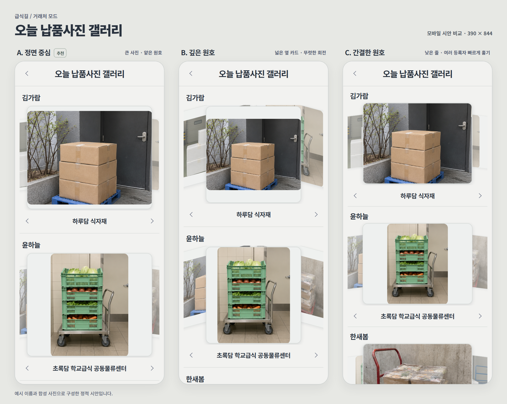
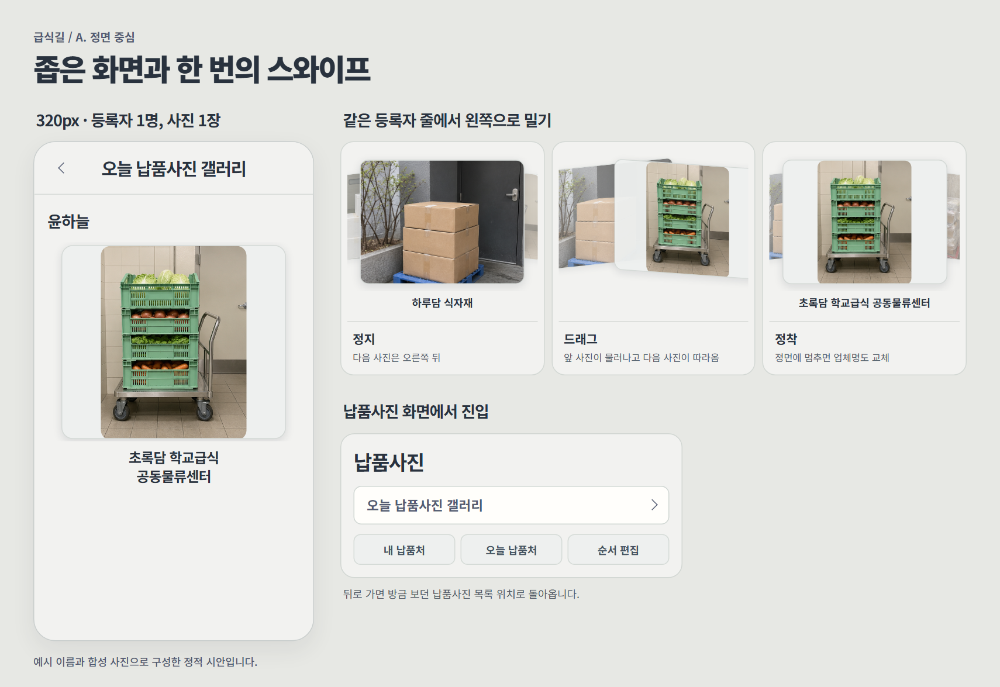

# 오늘 납품사진 갤러리 설계

2026-11-19 KST · 코드 기준 `9cbcd5b` · 설계 검토용

어제와 오늘을 이어 보고 업체별로 대조하는 후속 설계는 [어제와 오늘을 잇는 납품사진 갤러리](delivery-photo-two-day-gallery-design-20261119.md)에 정리했습니다.

**A안 ‘정면 중심’을 추천합니다.** 거래처 모드의 납품사진 상단에서 독립 갤러리로 들어가고, 등록자마다 한 줄에서 사진을 돌려 봅니다. 320px 화면에서 4:3 사진을 약 256×192px, 390px 화면에서 약 326×245px로 표시합니다. 양옆에는 뒤쪽 원호에 걸린 사진의 가장자리만 드러냅니다. 당일 서버 확인 목록과 권한이 적용된 이미지 읽기를 재사용하며, 첫 화면·첫 썸네일·첫 드래그를 각각 계측합니다.

## 1. 현재 코드에서 확인한 경로

| 항목 | 현재 동작 | 갤러리 재사용 지점 |
| --- | --- | --- |
| 진입과 돌아가기 | 거래처 홈의 납품사진은 앱 셸의 `customer/activity`를 열고 `DeliveryPhotoWorkspace`를 동적 로드합니다. URL을 공유하며 `onnuriwayShell` 이력과 `popstate`에서 화면을 복원합니다. 거래처 상세에서 바로 촬영으로 들어가는 `photo-record` 문맥도 있습니다. | 거래처 `activity` 내부에 갤러리 하위 화면을 추가합니다. [앱 셸](../src/features/app-shell/app-shell.tsx#L342) · [사진 화면 분기](../src/features/app-shell/app-shell.tsx#L472) |
| 오늘의 목록 | `useDeliveryPhotoData`는 서울 날짜·세션 버전·권한 버전에 묶인 메모리 스냅샷을 사용합니다. 새 읽기는 `getDeliveryPhotoRoute`, `getDeliveryPhotoDay`, `listDeliveryPhotos({scope:"today"})`를 병렬로 호출한 뒤 세 결과가 모두 도착해야 반영합니다. 캐시 재검증 기준은 60초입니다. | 이미 확인된 `snapshot.today`와 그 읽기를 공유합니다. 새 갤러리 소비자는 오늘 목록 응답만으로 시작합니다. [데이터 훅](../src/features/delivery-photos/use-delivery-photo-data.ts#L14) · [스냅샷과 확인된 사진 병합](../src/features/delivery-photos/delivery-photo-memory.ts#L22) |
| 조회 범위와 등록자 | 서버가 서울 날짜로 조회하고, 최신 원시 문서 501개로 상한 초과를 확인합니다. 500개로 자른 뒤 삭제·만료를 거릅니다. `photos`에는 `photoId`, `customerId`, `createdAt`, `createdByEmployeeId`, `createdByName`, 날짜·만료·썸네일 치수가 들어갑니다. `customers`는 거래처별 수량과 최신 사진 요약입니다. | 개별 사진의 배열인 `photos`를 사용합니다. `truncated`일 때 이어지는 메타데이터 조회가 있어야 누락된 등록자까지 표시할 수 있습니다. [당일 조회](../functions/src/delivery-photo/delivery-photo-service.ts#L585) · [응답 계약](../functions/src/delivery-photo/delivery-photo-contract.ts#L108) |
| 거래처명 | 납품사진은 `useDeliveryPhotoCatalog`에서 동일 세션의 거래처 메모리 카탈로그와 `customerRepository.subscribe`를 활용합니다. 기존 촬영 목록은 활성 거래처만 사용하고 카드 이름은 `Customer.name`입니다. 카탈로그 API는 전체 상태의 거래처를 페이지로 읽습니다. | 기존 카탈로그 전체에서 `customerId → name`을 구성합니다. 이름과 사진을 별개로 갱신하고 폐업 거래처도 카탈로그에 있으면 이름을 표시합니다. [카탈로그](../src/features/delivery-photos/use-delivery-photo-catalog.ts#L11) · [목록 API](../functions/src/customer/customer-service.ts#L77) · [카드](../src/features/delivery-photos/delivery-photo-row.tsx#L24) |
| 현재 이미지 경로 | 초기 납품사진은 업체명·완료 건수 등 메타데이터 중심입니다. 업체 이력을 열어야 이력 컴포넌트를 불러오고, 뷰포트 근처에서 `thumbnail`을 요청합니다. 한 장을 확대하면 `evidence`를 요청합니다. 현재 썸네일은 한 번 가까워지면 활성화 상태가 유지됩니다. | `getDeliveryPhoto` 요청·응답 검증과 Blob URL 등록·폐기를 재사용합니다. 여러 줄의 진입·이탈과 요청 우선순위는 갤러리에서 제어합니다. [이력 로더](../src/features/delivery-photos/delivery-photo-history-loader.tsx#L20) · [썸네일](../src/features/delivery-photos/delivery-photo-thumbnail.tsx#L21) · [확대](../src/features/delivery-photos/delivery-photo-viewer.tsx#L34) |
| 이미지 권한과 수신 | 두 Callable은 운영 App Check와 거래처 이용 권한을 적용합니다. `getDeliveryPhoto`는 Storage 읽기 전후에 권한, 활성·만료 상태, 파일 세대를 확인합니다. 클라이언트는 세션·ID·variant·길이·WebP 서명을 검사한 다음 Base64를 Blob으로 변환합니다. 객체는 private/no-store입니다. | 기존 Callable과 검증 함수를 통해 이미지를 읽습니다. 화면에서 쓰는 URL은 폐기 가능한 메모리 Blob URL입니다. [Callable](../functions/src/delivery-photo/delivery-photo-callables.ts#L27) · [권한·파일 검사](../functions/src/delivery-photo/delivery-photo-service.ts#L633) · [응답 변환](../src/features/delivery-photos/delivery-photo-history-repository.ts#L45) · [URL 정리](../src/features/auth/private-client-state.ts#L12) |

여기서 ‘오늘 등록’은 서버가 저장한 `deliveryDateKey` 기준입니다. 등록 요청을 처음 받은 시점에 서버가 정한 서울 날짜를 따릅니다. 자정을 넘긴 재전송이 이전 날짜로 확정되면 해당 날짜의 기존 이력에서 조회됩니다. [등록 날짜와 보관 산정](../functions/src/delivery-photo/delivery-photo-service.ts#L470)

## 2. 모바일 시안

| 후보 | 390px 화면의 4:3 정면 사진 | 뒤쪽 카드와 줄 구성 | 사용감 |
| --- | --- | --- | --- |
| **A. 정면 중심 · 추천** | 약 326×245px. 세로 3:4 사진은 약 202×269px | 좌우 14–22px 정도 노출, 정면보다 약 15px 위, 크기 약 69%, 불투명도 약 54%. 줄마다 약 380px 확보 | 여러 줄이 함께 보여도 확인할 사진이 눈에 먼저 들어옵니다. 옆 사진은 방향과 순서를 알려줍니다. |
| B. 깊은 원호 | 약 248×186px. 세로는 약 189×252px | 좌우 45–60px, 높이 차이 약 34px, 옆 기울기 약 15°. 뒤쪽이 더 많이 보입니다. | 다음 사진의 내용과 회전 방향을 빨리 알아볼 수 있습니다. A보다 정면 가로 폭이 약 24% 줄고 줄이 연달아 보일 때 시선 경쟁이 커집니다. |
| C. 간결한 원호 | 약 281×211px. 세로는 약 158×211px | A와 비슷한 얕은 깊이에 211px 높이의 프레임. 줄 간격을 줄여 다음 등록자 사진을 더 일찍 보여 줍니다. | 등록자가 많은 날에 훑어보기 좋습니다. 세로 사진 확인에는 확대 조작이 더 자주 필요할 수 있습니다. |

추천안은 기존 `--shell-canvas` `#f2f2f0`, `--shell-ink` `#29323e`, `--shell-accent-deep` `#535b72`와 Pretendard·Noto Sans KR 계열을 사용합니다. 사진 받침은 밝은 무채색과 얇은 테두리, 반경 약 12px로 정리합니다. 독립 화면 상단에는 뒤로 가기와 20–22px 제목을 둡니다. 본문에서는 등록자 이름을 줄 왼쪽에 18px 제목으로 한 번 표시하고, 정면 사진 아래 가운데에 16px 업체명을 둡니다. 이전·다음 화살표는 업체명 양 끝의 별도 44×44px 버튼입니다. 상단은 기존 중립 배경을 쓰며 줄은 구분선과 여백으로 이어집니다. [급식길 색상](../src/app/styles/field-theme.css#L73) · [기본 글꼴](../src/app/styles/base.css#L17)

- **화면 크기와 비율.** 좌우 기본 12px와 안전 영역을 확보한 뒤, 정면 프레임은 줄의 폭에서 약 40px를 덜어 씁니다. 모바일 높이 시작값은 `clamp(220px, 69vw, 300px)`입니다. 중앙 사진을 `object-fit: contain`으로 정면에 배치하고 크기는 썸네일 치수로 예약합니다. 320px에서 3:4 세로 사진은 약 166×221px입니다. 가로·세로가 번갈아 나와도 프레임과 캡션의 시작점이 유지됩니다. 태블릿은 갤러리 폭을 중앙에 모아 한 열로 읽습니다.
- **업체명과 스크롤.** 업체명 폭은 가운데 영역만 쓰고, 한국어는 단어 단위 줄바꿈을 우선합니다. 긴 연속 문자열도 다음 줄로 넘깁니다. 두 줄 높이를 기본 확보하고 그 이상은 전체 이름이 흐름 안에서 늘어나게 합니다. 등록자가 많은 날은 제목·캡션·예약된 높이로 세로 목록을 구성하고 근처 줄에만 사진 카드를 붙입니다.
- **0명·1명·여러 명.** 조회가 끝나고 0명이면 “오늘 등록된 납품사진이 없어요”와 뒤로 가기를 표시합니다. 1명이면 한 줄, 여러 명이면 각 한 줄이 생깁니다. 사진 1장은 고정 정면으로 보여 주고 화살표를 생략합니다. 사진 2장은 이동 가능한 방향에만 이웃을 보여 주며 두 장 사이를 왕복합니다. 3장부터 양쪽 원호에서 이어지고 마지막 다음은 첫 사진입니다.
- **상태.** 첫 진입은 제목과 사진 자리 하나를 바로 표시합니다. 목록 오류는 상단에서 다시 시도하고, 사진 한 장의 다운로드·디코드 오류는 해당 줄에서 재시도합니다. 다음 사진의 수신이 늦어도 정착과 업체명 교체는 이뤄지며 그 카드에서 로딩 상태를 보여 줍니다. 카탈로그 지연 중에는 업체명 자리를 확보하고, 조회 완료 후에도 매칭되는 업체가 없으면 “업체명 확인 불가”를 표시합니다. 권한 거절이면 사진·이름을 가리고 재로그인 안내로 전환합니다.

## 3. 회전 동작과 렌더링 기술

### 레퍼런스에서 확인한 동작

React Bits의 375px 프리셋은 확인한 환경에서 실제 캐러셀 영역이 약 373px였습니다. 기본 예제는 원통·정사각 카드·자동 회전을 사용합니다. 브라우저에서 자동 회전을 끄고 마우스로 왼쪽으로 드래그하자 정면 후보가 바뀌었고, 손을 놓은 후 원통 각도가 약 −58°에서 36° 간격의 다음 슬롯인 −72°로 더 회전해 정착했습니다. 확인한 데모에서는 열 장에 `img` 노드 160개와 `preserve-3d`가 사용됐습니다. 공개 코드의 곡면은 면 하나를 여덟 조각으로 나누며, RAF와 릴리스 속도를 이용해 가까운 슬롯으로 스냅합니다. 노드 수는 렌더링 구조 관찰값이며 휴대폰 성능은 실기기에서 별도로 측정합니다. [React Bits Circular Carousel의 Preview와 Code](https://reactbits.dev/components/circular-carousel)

### 추천안의 드래그와 정착

1. 각 줄은 정착된 `photoId`와 드래그 중의 연속 위치를 독립적으로 갖습니다. 원호에서 가로 위치는 `sin(각도)`, 뒤로 물러나는 정도는 `1 − cos(각도)`에 비례시킵니다. 첫 옆 슬롯은 390px 화면에서 중심축에서 약 111px 떨어지고 사진 위쪽으로 약 15px 이동합니다. 옆 사진의 기울기는 약 7°에서 정면의 0°로 풀리고, 정면은 배율 1·불투명도 1로 고정됩니다. 화면에 가려지는 뒤쪽에서 다음 슬롯이 이어집니다.
2. 포인터 이동이 약 8px를 넘고 가로 변화가 세로의 1.25배 이상일 때 해당 줄이 제스처를 잡습니다. 한 장 간격은 시작값으로 가용 폭의 약 58%를 사용합니다. 이동량을 바로 위치로 반영하며, 이미지 수신 상태와 독립적으로 동작합니다. 세로로 시작한 입력과 핀치는 브라우저에 맡깁니다. [Pointer Events와 touch-action](https://www.w3.org/TR/pointerevents3/#the-touch-action-css-property)
3. 손을 놓으면 최근 약 80ms의 이동으로 관성을 추정합니다. 느리게 밀었을 때는 가까운 슬롯으로, 빠르게 튕겼을 때는 진행 방향으로 정착시키되 한 번의 릴리스에서 최대 한 장만 넘깁니다. 200–300ms 감속과 오버슈트 없는 정착을 초기값으로 둡니다. 새 입력은 정착 도중의 위치에서 바로 이어집니다. `pointercancel`·캡처 상실은 마지막 확정 카드에 정착시킵니다. 나가거나 날짜가 바뀌면 즉시 종료합니다.
4. 두 카드가 정면을 공유하는 구간에는 캡션 높이를 확보한 채 이름을 잠시 가립니다. 정중앙 사진 ID가 확정될 때 표시 이름과 스크린 리더 안내를 한 번 바꿉니다. 드래그 중 누른 동작이 사진 확대 클릭으로 이어지지 않게 합니다. 자동 재생, 진입 시 회전, 패럴랙스와 탄성 팽창은 각각 0으로 둡니다.

| 방식 | 장점과 렌더링 비용 | 선택 |
| --- | --- | --- |
| React Bits식 분할 곡면 CSS 3D | 원통 회전과 연속적인 굴곡이 뚜렷합니다. 앞뒤 면을 여러 조각으로 구성하고 사진마다 합성·클리핑 작업이 증가할 수 있습니다. | 감각 참고. 같은 10장·여러 줄 기준으로 노드 수와 합성층을 확인할 비교군입니다. |
| 단일 카드 CSS 3D | 각 사진을 한 평면에 놓고 `perspective`·`rotateY`·`translateZ`로 실제 깊이를 표현할 수 있습니다. 장면의 클리핑, 투명도, `preserve-3d` 조합에 따른 평탄화와 깊이 정렬을 두 엔진에서 확인해야 합니다. | 2D 투영의 깊이가 부족할 때 같은 구조에서 비교합니다. [CSS Transforms의 그룹 속성](https://www.w3.org/TR/css-transforms-2/#grouping-property-values) |
| **각도를 2D에 투영한 DOM 카드** | 원호의 시각적 깊이를 `translate/scale/skew/opacity`와 쌓임 순서로 표현합니다. 정면 한 장은 온전한 `img`이고, 드래그 중에는 활성 줄의 소수 카드만 RAF로 갱신합니다. | **추천.** 적은 노드와 얕은 합성 구조에서 제스처 중 비용이 줄어드는지 검증할 수 있고, 일반 DOM을 읽기·조작·확대에 쓸 수 있습니다. |
| 네이티브 가로 스크롤 + CSS Scroll Snap | 모바일의 기본 수평 입력과 스냅 처리가 장점입니다. 직선 배치이며 원호 회전 표현이 제한됩니다. | 동작 줄이기 또는 호환성 문제가 있는 경우의 단순 보기입니다. 동작 줄이기에서 버튼은 즉시 한 장을 바꿉니다. |

드래그 표면의 `touch-action: pan-y pinch-zoom`으로 수직 스크롤과 시스템 확대를 허용하고, 가로 축을 확정한 뒤 포인터를 캡처합니다. 이동 중에는 해당 줄의 transform·opacity만 프레임마다 갱신하고 React 상태는 정착 시점에 반영합니다. 한 줄의 정지 상태는 현재 카드와 이웃 두 자리로 구성하며, 회전 중에는 필요한 최대 다섯 슬롯을 사진 ID당 한 번씩 준비합니다. 정지 상태에서 RAF를 종료하고, 상시 `will-change`와 동적 블러를 피합니다. iOS에서 사진 겹침과 깜박임·합성 메모리·시스템 뒤로 가기, Android에서 디코딩과 드래그가 겹칠 때의 프레임 타임과 대각선 스크롤을 확인합니다. [Safari Web Inspector](https://developer.apple.com/safari/tools/) · [Chrome Performance 도구](https://developer.chrome.com/docs/devtools/performance/reference)

줄 제목은 이름이 있는 그룹에 연결합니다. 화살표는 탭·클릭·키보드 Enter/Space로 동작하고 포커스가 해당 줄에 있을 때 좌우 키도 사용할 수 있습니다. 정착한 사진과 업체명만 보조기술에 노출하고, 사용자가 넘긴 뒤에만 업체명과 위치를 `polite`로 안내합니다. 장식용 대기 카드는 포커스와 접근성 트리에서 제외합니다. `prefers-reduced-motion`에서는 원호 변형과 관성을 끄고 정적인 스냅 또는 즉시 전환을 제공합니다. VoiceOver·TalkBack, 고대비와 글자 200%로 확인합니다. [WAI Carousel 패턴](https://www.w3.org/WAI/ARIA/apg/patterns/carousel/) · [WCAG 드래그 대체 조작](https://www.w3.org/WAI/WCAG22/Understanding/dragging-movements)

## 4. 진입, 데이터와 이미지

`진입 → 화면 틀 표시 → 등록자 줄과 업체명 표시 → 중앙 썸네일 표시`

화면 틀이 나타나는 동안 코드와 당일 메타데이터를 준비합니다. 거래처 카탈로그는 업체명을 채우며, 썸네일 수신과 디코딩은 등록자 줄의 제스처와 독립적으로 진행합니다.

### 화면이 뜨는 경로

1. 납품사진 제목 영역 아래, 납품처 관리 조작 앞에 **오늘 납품사진 갤러리** 버튼을 둡니다. 권한이 유효하면 오늘 목록이 로딩 중이거나 비어도 들어갈 수 있습니다. 앱 셸은 같은 `customer/activity`에 갤러리 이력 한 칸을 추가하고, 이미 로드한 최소 셸에서 제목·뒤로 가기·사진 자리를 먼저 그립니다. 갤러리 본문과 스타일의 동적 import를 누르는 시점에 시작하고, 필요한 오늘 목록 조회도 동시에 시작합니다.
2. 원래 화면의 스크롤·검색어·촬영 문맥을 메모리에 두고 갤러리는 맨 위부터 시작합니다. 목록 화면은 같은 화면 소유자 아래 비표시로 전환해 활성 입력과 포커스를 갤러리에서만 받게 합니다. 확인된 업로드의 상태 반영은 기존 소유자가 담당합니다. 상단 뒤로 가기와 시스템 뒤로 가기는 같은 이력 항목을 닫고 원래 스크롤과 진입 버튼의 포커스를 복원합니다. 새로고침 뒤에는 기존 납품사진 화면으로 복귀합니다. 화면 이력에는 하위 화면 식별자만 기록합니다.
3. 초기 납품사진 코드에는 버튼과 전환 분기를 추가합니다. 현재 로컬 빌드 산출물에서 납품사진·이력·확대 동적 경계의 파일은 각각 두 개이며, `out/index.html`에는 없지만 `public/sw.js`에는 들어 있었습니다. **갤러리의 import를 지연해도 설치·업데이트 선캐시가 파일을 먼저 받을 수 있습니다.** 다음 빌드의 모듈·청크 매핑에서 갤러리 전용 파일을 찾아 설치 선캐시에서 제외합니다. 갤러리 이전의 해당 파일·이미지 요청 목표는 0건입니다. 기존 빌드/Hosting 예산과 새 설치·업데이트 시 요청 추적을 함께 확인합니다. [Serwist 설정](../next.config.ts#L22) · [서비스 워커 캐시](../src/app/sw.ts#L32) · [기존 납품사진 번들 예산](../scripts/verify-phase16-performance-build.mjs#L474)

### 당일 목록과 그룹

1. 오늘 목록 부분만 세션·날짜에 묶인 공유 읽기로 분리합니다. 같은 서울 날짜이고 권한이 유효한 60초 이내 스냅샷을 사용하거나, 납품사진에서 이미 실행 중인 `listToday`에 합류합니다. 둘 다 없으면 `listToday`를 한 번 호출합니다. 갤러리의 첫 사진은 오늘 납품처 순서·전송함 준비를 기다리지 않습니다. 기존 화면은 날짜가 같은 세 응답을 사용합니다. 공유 읽기는 현재 스냅샷의 세대 검사를 재사용해, 조회를 시작한 뒤 서버에서 확인된 업로드를 보존하고 삭제된 사진의 재등장을 막습니다. 같은 날에는 진입·복귀·재연결 때 60초 기준을 적용해 재검증합니다.
2. 서울 날짜가 같고 유효한 사진의 `photoId`를 중복 제거한 뒤 `createdByEmployeeId`로 묶습니다. 사진은 `createdAt` 내림차순과 `photoId`로 순서를 고정합니다. 줄 제목은 그룹에서 가장 최근 사진에 저장된 `createdByName`을 사용합니다. 이름이 같은 서로 다른 직원도 각자 한 줄입니다. 첫 진입 시 최근 등록 순으로 줄을 배열하고, 같은 날 재검증 중 이미 보고 있는 줄과 선택 사진의 위치를 보존합니다. 새로 확인된 그룹은 이어 붙입니다. 삭제가 확인돼 선택 사진이 없어지면 가까운 사진으로 옮기고 마지막 한 장이었다면 그 줄을 제거합니다.
3. `truncated: true`이면 도착한 목록부터 표시하면서 같은 Callable의 갤러리 전용 **페이지 조회 분기**로 이어 읽습니다. 기존 응답에 마지막 원시 문서의 커서가 없으므로 이 분기에서는 앞부분 메타데이터를 다시 읽습니다. 강한 부하를 피하도록 순차 호출하며 페이지마다 원시 문서는 최대 200개를 읽습니다. `createdAt`과 문서 ID 내림차순의 커서와 서울 날짜를 검증합니다. 페이지 도중 삭제되거나 필터 후 빈 페이지여도 마지막 원시 문서부터 이어갑니다. 스캔 중에는 `photoId`로 중복을 제거해 먼저 그립니다. 스캔이 끝나면 새 조회 결과와 그동안 확인된 업로드·삭제로 최종 목록을 확정합니다. 다른 기기에서 뒤늦게 확정된 사진은 다음 재검증에서 받습니다. 기존 두 분기와 갤러리 분기는 같은 App Check·권한 확인을 적용합니다. 쿼리·색인 호환은 에뮬레이터와 배포 후보에서 확인합니다. 전체 페이지 확인 전에는 진행 상태를 표시하고 실패한 페이지는 이어서 다시 시도합니다. [현재 조회 상한](../functions/src/delivery-photo/delivery-photo-service.ts#L585) · [현재 날짜 색인](../firestore.indexes.json#L44)

### 첫 사진, 다음 사진, 큰 사진

- **첫 사진.** 첫 번째 보이는 줄의 중앙 썸네일을 가장 먼저 요청합니다. 검증·Blob 생성·`img.decode()` 뒤 표시합니다. 다음 우선순위는 다른 보이는 줄의 중앙, 그리고 조작 중이거나 포커스된 줄의 가까운 이웃입니다. `IntersectionObserver`의 root는 기존 `.workspace-content`입니다. 화면 가까이 도착한 줄의 레이아웃을 먼저 준비하고, 실제 이미지 수신은 보이는 줄과 활성 줄의 이웃으로 제한합니다.
- **선명도.** 썸네일은 긴 변 최대 640px, 저장용 큰 사진 `evidence`는 신규 처리 기준 최대 2560px WebP입니다. 390px의 326px 사진을 DPR 3에서 보면 썸네일을 확대해 그리므로 세부 라벨까지 판독할 수 있는지 검증합니다. 정면은 썸네일을 즉시 보여 주고, 사용자가 정면을 탭해 자세히 볼 때 해당 사진의 `evidence` 한 장을 받아 기존 확대·이동 기능으로 엽니다. 뒤로 가기로 확대부터 닫고 같은 줄과 사진으로 복귀합니다. [파생 이미지 크기와 품질](../functions/src/delivery-photo/delivery-photo-processor.ts#L13) · [기존 확대 컴포넌트](../src/features/delivery-photos/delivery-photo-viewer.tsx#L19)
- **요청과 취소.** 키는 `세션(UID·직원 ID·두 버전) / 서울 날짜 / photoId / variant`입니다. 동일 키의 진행 요청은 하나만 유지하고 구독을 합칩니다. 동시에 애플리케이션 요청 두 개, 백그라운드 이웃 요청 한 개로 시작합니다. 연속 스와이프·줄 이탈 때 대기열에서 불필요한 요청을 빼고, 새 정착 사진과 진행 방향 이웃을 앞으로 올립니다. 기존 일반 `httpsCallable`에 `AbortSignal`이 전달되지 않아 시작한 HTTP 요청과 SDK의 응답 파싱은 계속될 수 있습니다. 아직 유효한 같은 키가 다시 필요하면 진행 요청을 재사용합니다. 그 외 완료 응답은 Blob 변환 전에 폐기하고, 폐기한 요청도 SDK 호출이 끝날 때까지 슬롯에 포함합니다. 날짜·권한 변경은 모든 구독에 즉시 적용합니다. [현재 이미지 호출](../src/features/delivery-photos/delivery-photo-history-repository.ts#L82) · [Firebase Callable 옵션](https://firebase.google.com/docs/reference/js/functions.httpscallableoptions)
- **메모리.** 줄이 충분히 멀어지면 이미지 엘리먼트를 떼고 사진 위치 ID만 남깁니다. 갤러리 안에서는 이미지 Blob을 최근 사용 기준 최대 8개 또는 압축 2MiB 중 먼저 차는 한도로 재사용합니다. 화면 사용 중인 슬롯을 우선 확보하고 오래된 미사용 Blob과 URL을 폐기합니다. 확대는 별도의 한 장 수명으로 관리하며 닫으면 즉시 반납합니다. 최대 640² RGBA 썸네일 8개는 약 12.5MiB, 2560² RGBA 한 장은 약 25MiB입니다. 합성 텍스처·임시 Base64 변환과 디코드 버퍼가 추가될 수 있으므로 픽셀 메모리 추정치로 사용합니다. 브라우저의 실제 메모리는 도구로 측정합니다. [기존 Blob URL의 수명](../src/features/delivery-photos/use-delivery-photo-image.ts#L22)

## 5. 서울 자정과 세션 수명

현재 납품사진 훅에는 서울 자정 타이머와 포커스·복귀 확인이 있습니다. 핸들러는 숨김·오프라인이면 먼저 반환합니다. 갤러리는 `Asia/Seoul`의 `YYYY-MM-DD`를 구해 해당 날짜 다음 날의 00:00 KST에 타이머를 예약합니다. 만료 판정을 네트워크 도달 여부보다 먼저 수행하고, 날짜가 바뀌면 다음 자정으로 다시 예약합니다. [서울 날짜 계산](../src/features/delivery-photos/delivery-photo-memory.ts#L13) · [현재 자정·복귀 로직](../src/features/delivery-photos/use-delivery-photo-data.ts#L53)

| 상황 | 설계 동작 |
| --- | --- |
| 열린 상태에서 00:00 KST | 서울 날짜 키와 화면 세대를 먼저 교체합니다. 이전 줄·이름과 확대 화면을 가리고, 포인터 캡처·RAF·대기 요청을 종료합니다. 이전 날짜의 이미지 참조·Blob URL·행 선택 상태를 반납한 뒤 새 날짜 로딩 화면을 표시합니다. 온라인이면 새 날짜 조회를 시작합니다. |
| 백그라운드, BFCache, 오프라인 | `visibilitychange`로 숨기거나 `pagehide`가 발생하면 갤러리 사진을 가리고 제스처를 멈춥니다. `pageshow`·가시화·포커스·재연결에서 날짜와 세션을 먼저 확인한 후 같은 날만 다시 표시합니다. 시각 검증 전 화면에 이전 날짜 사진이 한 프레임이라도 드러나는지 녹화로 확인합니다. 오프라인으로 자정을 넘기면 새 날짜의 연결 안내를 표시하고, 연결 후 조회합니다. [뒤로/앞으로 캐시와 복귀](https://web.dev/articles/bfcache) |
| 어제 요청이 오늘 도착 | 요청 시작 시 세션·날짜·세대를 캡처하고 목록 수신·Blob 생성·디코드 완료·화면 적용 직전에 현재 값과 대조합니다. 서버 목록의 `deliveryDateKey`도 예상 날짜와 같아야 합니다. 늦은 응답은 갤러리에 커밋하지 않고 이미 만든 URL이 있으면 폐기합니다. 날짜 불일치가 반복되면 기기 시각 확인과 재시도를 안내합니다. |
| 로그아웃·권한 변경·화면 종료 | 권한이 바뀌면 갤러리 목록과 이미지 접근을 즉시 차단하고 기존 private cleanup에 연결합니다. 뒤로 갈 때는 갤러리 임시 상태와 URL을 정리하고, 납품사진 목록의 같은 날 메타데이터 메모리는 재사용합니다. |

갤러리는 서버 확인 사진의 조회 화면입니다. 갤러리용 사진 객체·일별 문서·클라이언트 영구 이미지 캐시는 각각 0개입니다. 메모리 정리는 갤러리에서 소유한 임시 리소스에 적용합니다. 원본 사진 계열의 보관은 기존 168시간 정책과 시간 단위 정리 작업을 따릅니다. [보관 시간](../functions/src/delivery-photo/delivery-photo-contract.ts#L10) · [정리 일정](../functions/src/delivery-photo/delivery-photo-callables.ts#L106)

## 6. 성능 목표와 측정

아래 수치는 구현 검토를 위한 **목표**입니다. 이번 조사에서 확인한 값은 시안의 크기, 레퍼런스의 동작, 현재 코드·로컬 산출물의 로딩 경로입니다.

**비교 조건.** 기준 커밋과 후보 빌드를 같은 데이터·서비스 지연·브라우저에서 교대로 실행합니다. 공통 경로인 ‘거래처 홈 → 납품사진’의 초기 비용과, 업무 비교 경로인 ‘이미 열린 납품사진 → 업체 이력 → 같은 사진의 첫 썸네일/확대’를 각각 기록합니다. 갤러리 제스처는 동일 사진·같은 노출 카드 수로 추천 2D 카드와 단일 CSS 3D를 비교하고, React Bits 데모는 회전 감각의 참고로 사용합니다.

- 390×844와 320px 폭, 여러 종횡비의 같은 합성 WebP 및 메타데이터를 사용합니다. 보통은 등록자 3명·30장, 다량은 40명·575장으로 두고 같은 시간·동명이인·삭제 문서·501번째 이후에만 나오는 등록자를 섞습니다. 추가로 500개보다 많은 삭제 문서 탓에 첫 응답의 사진 배열이 비어 있는 경우를 만듭니다.
- 보통 망은 다운/업 8/2 Mbps·RTT 60ms, 느린 망은 1.6/0.75 Mbps·RTT 150ms로 시작합니다. 브라우저 자동화의 CPU 4× 제한과 동일 응답 지연은 재현용입니다. 실제 저사양 Android Chrome과 iPhone Safari/WebKit에서 일반 탭·설치 PWA를 따로 기록합니다. 빌드 청크·오늘 캐시가 모두 없는 조건, 납품사진의 오늘 캐시만 있는 조건, 갤러리 내부에서 썸네일이 남아 있는 조건을 제어합니다.
- 주요 조건은 최소 20회씩 교차 실행하고 p50·p75·p95, 오류·취소 건수를 남깁니다. Functions/App Check 콜드 스타트와 캐시 유무를 기록합니다. 실기기 프레임 수치는 주사율과 기기·OS·브라우저 버전을 함께 남깁니다.

| 지표 | 목표 | 측정 방법 |
| --- | --- | --- |
| 최초 납품사진 화면의 증가분 | 갤러리 전용 JS/CSS·목록 추가 호출·이미지 요청은 진입 버튼 클릭 전 **0**. 공통 추가 JS/CSS 합계 ≤1KiB gzip, 납품사진 화면 표시 p75 회귀 ≤50ms | Next 빌드 의존관계와 `preload` 확인. 앱 시작/사진 모드 진입의 요청 waterfall 및 SW 첫 설치·업데이트 설치 로그 검사. 기존 납품사진의 번들 예산도 함께 통과. |
| 갤러리 첫 화면 | 클릭→제목·뒤로 가기·스켈레톤 실제 표시 p75 ≤150ms, 저사양·느린 망 p75 ≤250ms | 클릭 시각과 셸 커밋 후 프레임에 User Timing 표시. 2 RAF는 표시 시점의 근사값으로 쓰고 스크린샷 필름스트립과 맞춰 확인. |
| 첫 사진 | 보통 망 p75 ≤0.8초(오늘 메타데이터 있음) / ≤1.4초(없음). 느린 망 p75 ≤1.8초 / ≤2.6초, 콜드 메타데이터 p95 ≤4.5초. 다량의 첫 썸네일도 같은 느린 망 기준 | 클릭→정면 썸네일 디코드 완료 후 실제 표시. 청크·`listToday`·이미지 전송·Base64 변환·디코드 시간을 각각 표시. 위쪽 줄 이미지가 화면에 찍혔는지 필름스트립으로 확인. |
| 다량 메타데이터 | 40명·575장 fixture에서 직원 ID와 사진 집합이 전부 일치하고, 느린 망의 전체 목록 확인 p75 ≤8초 | 첫 사진 지표와 별도로 마지막 페이지 커밋을 표시. 커서가 진행하는지와 전체 페이지 완료 전 빈 화면으로 확정하는 경우가 없는지 확인. |
| 정면 세부 확인 | 이미지가 로드된 뒤 3:4·4:3 전체 내용과 라벨 판독을 확인. 명시적인 확대는 정면 ID에 대한 `evidence` 1회, 확대 후 닫으면 같은 사진으로 복귀 | 320/390px, DPR 2–3에서 합성 글자 라벨을 읽어 보고 100% 갤러리 표시와 확대를 교차 확인. |
| 스와이프 반응·끊김 | 가로 축을 잡은 첫 이벤트→첫 변화 프레임 p95 ≤50ms. 60Hz 기기에서 드래그/정착 중 프레임 간격 p95 ≤22ms, 32ms 초과 <5%, 릴리스→정착 p95 ≤320ms. 중앙 오차 ≤1 CSS px | RAF 기록과 Android Chrome 프레임 트랙·iOS Safari 렌더링 프레임 및 녹화로 대조. 같은 줄 10회 왕복, 3줄 교차 30회, 디코드 지연·오류 중 재드래그, 대각선 세로 스크롤. 다른 줄의 위치 이동 0건. |
| 호출 수와 바이트 | 첫 사진이 표시될 때까지 이미지 POST 1회. 390px 고정 뷰포트의 첫 묶음은 보이는 줄 수를 R이라 할 때 ≤R+2, evidence 0. 재사용 가능한 키의 중복 시작 0. 대표 fixture 썸네일 첫 응답 p95 ≤120KiB, 4건 합계 ≤480KiB 전송 | Network에서 Callable POST 요청·CORS preflight·토큰·전송 바이트를 각각 집계. 가려진 줄 스크롤·빠른 방향 전환에서 큐에서 사라진 작업과 실제 수신한 뒤 폐기된 작업을 따로 셈. |
| 메모리와 이탈 | 갤러리 썸네일 Blob ≤8개/2MiB, 갤러리 소유 URL은 이탈·날짜/권한 변경 후 0. 스크롤 피크는 기준 사진 화면 대비 증분 ≤25MiB의 초기 목표. 동일 경로 5회 반복 후 안정 시 기준 대비 ≤5MiB 및 단조 증가 0 | 갤러리 자체 계측으로 Blob·DOM·RAF·큐를 추적. Chrome Memory/Performance와 Safari Timelines/Layers로 JS와 이미지·합성 메모리 추세를 검토. 도구가 제공하는 범위와 프로세스 메모리 변동을 보고. |

실기기에서 먼저 검증할 가설은 A의 640px 썸네일 판독성, 2D 투영의 정착감과 프레임 안정성, 사진 디코드가 드래그와 겹칠 때의 Android 메인 스레드 비용, iOS의 스크롤·핀치·복귀 동작입니다. 정면에서 더 높은 해상도가 필요한지는 판독 검증으로 판단합니다. [Chrome 프레임 분석](https://developer.chrome.com/docs/devtools/performance/reference) · [iOS Safari 검사](https://developer.apple.com/safari/tools/)

## 7. 다음 구현 범위와 검증 순서

1. **화면 전환과 한 줄.** 앱 셸·납품사진 툴바에 진입·복귀를 연결하고, 지연 로딩되는 갤러리 본문과 CSS에서 한 줄을 확인합니다. 합성 사진으로 320/390px·가로/세로·긴 상호명·확대 글자, 0/1/여러 명, 1/2/3장, 키보드와 동작 줄이기를 먼저 검증합니다.
2. **조회와 날짜.** `listToday`의 공유 읽기, 거래처 이름 매핑, 직원 ID 그룹, 선택 ID 유지, 확인된 업로드·삭제 병합을 검증합니다. 500/501건과 575건, 잘린 첫 응답 0건, 페이지 재시도와 동률 커서를 Functions 단위·에뮬레이터에서 확인합니다. 서울 자정 직전/직후에는 목록 응답·이미지 응답·디코드를 각각 지연시키고, 백그라운드/BFCache·오프라인·다른 기기 표준 시간대·권한 변경에서 이전 사진 DOM과 URL이 재등장하는지 확인합니다.
3. **보호 이미지와 회전.** 늦은 썸네일, 전송·디코드 실패, 빠른 왕복과 줄 교차, 스크롤·핀치·포인터 취소, 확대 열기/닫기의 복귀, 접근성 이름을 확인합니다. 화면 뒤로 가기·시스템 뒤로 가기·앞으로 가기, 연속 촬영에서 진입 후 복귀, 진행 중인 업로드와 앱 전환도 검사합니다. 현재 사진 로딩·회귀 fixture를 재사용합니다. [기존 사진 회귀 테스트](../tests/e2e/delivery-photo-audit-fixes.spec.ts#L50) · [확대 테스트](../tests/e2e/delivery-photo-pan-zoom.spec.ts#L30)
4. **번들·PWA·실기기.** 관련 단위·브라우저·에뮬레이터 검사를 통과한 후보의 타입·린트, Hosting 빌드와 초기·PWA 예산을 확인합니다. 갤러리 전용 청크가 첫 로딩·설치 시 새로 내려오지 않는지 확인합니다. 마지막으로 저사양 Android와 iOS에서 위 수치를 측정하고, 성능과 500건 초과 조회가 기준을 충족하는 후보를 릴리스 검토에 올립니다.

시안은 내장 이미지 생성으로 만든 가상 납품 장면을 사용했습니다. 화면은 로컬 Playwright에서 정적으로 렌더링했고 390px 비교와 320px 상세에서 사진 비율 및 캡션 가로 넘침을 확인했습니다.

시안 사진의 생성 입력

> Create a single photorealistic 2-by-2 contact sheet of four fictional Korean food-service delivery snapshots, for a Korean workplace app design study. Four equal rectangular quadrants edge to edge, sharp straight joins at the midpoint, no frames or gutters. Top left: three kraft food cartons stacked on a blue pallet near a charcoal gray service door in indirect daylight. Top right: a portrait-friendly centered stack of mint-green produce crates on a stainless trolley near cream tile and a plain service entrance. Bottom left: clear wrapped food boxes on a red warehouse dolly beside a plain concrete wall. Bottom right: a stack of white insulated boxes in a clean loading bay with a blue cart. Medium wide phone photos with unstyled field-documentation lighting and believable textures. The shots must have distinct muted palettes. No logos, readable text, addresses, people, license plates, interface or captions.

